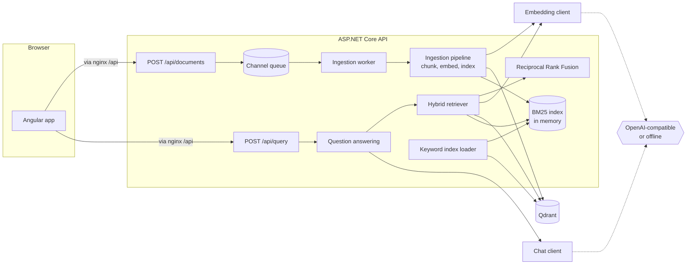

# Document Intelligence RAG

A retrieval-augmented question answering service for your own text and Markdown documents.
Upload documents, and the API chunks, embeds and indexes them in the background; ask a
question, and it retrieves relevant passages with hybrid search, asks a chat model to answer
only from those passages, and returns the answer together with the passages it cited.

- **Backend:** ASP.NET Core 8 minimal API (`src/`)
- **Frontend:** Angular 20 single-page app (`web/`)
- **Vector database:** Qdrant, or an in-memory store for local runs and tests
- **Models:** any OpenAI-compatible endpoint (OpenAI, Ollama, ...), or deterministic offline
  stand-ins so the whole system runs with no model and no credentials

## Architecture



### Ingestion

1. `POST /api/documents` validates the upload (`.txt`, `.text`, `.md`, `.markdown`; UTF-8;
   size limit) and returns `202 Accepted` with an ingestion job. The document is placed on a
   bounded `Channel<T>`; when the queue is full the upload is refused with `503`.
2. A hosted `BackgroundService` drains the queue one document at a time and records each
   job's status (`Queued`, `Processing`, `Completed`, `Failed`), exposed at
   `GET /api/ingestions/{id}`.
3. The `TextChunker` splits the text into sentences and packs them into chunks of at most
   `Chunking:MaxTokens` tokens (counted with the `o200k_base` encoding), repeating trailing
   sentences of each chunk at the start of the next up to `Chunking:OverlapTokens`. Sentences
   that are too long fall back to word and then character splits. In Markdown, headings are
   hard boundaries and each chunk records its heading path (for example
   `Handbook › Leave › Carry over`).
4. Chunks are embedded in batches and written to the vector store and to the BM25 index.
   Chunk ids are derived from the document id and chunk position, so re-ingesting a document
   replaces its chunks. If a batch fails, the partially written document is removed.

### Retrieval and answering

1. The question is embedded and sent to the vector store (cosine similarity), and the same
   question is scored against the BM25 keyword index.
2. The two rankings are fused with Reciprocal Rank Fusion (`score = Σ 1 / (k + rank)`), which
   only uses ranks, so cosine scores and BM25 scores never need to be calibrated against each
   other. Each result keeps its rank in both lists.
3. The top chunks are placed in a grounded prompt as numbered `<source>` blocks. The system
   message tells the model to answer only from the sources, cite them as `[n]`, and say when
   the sources do not cover the question.
4. The `[n]` markers in the reply are parsed and mapped back to chunks; the response contains
   the answer and the cited chunks (document, section, chunk index, text, fused score).

The BM25 index lives in memory. On start-up a hosted service rebuilds it by scrolling every
chunk out of Qdrant, retrying until Qdrant is reachable; the ingestion worker waits for that
to finish, and `/health/ready` reports unhealthy until it has.

### Offline mode

With `Ai:Provider = Offline` (the default):

- **Embeddings** come from `HashingEmbeddingClient`: terms and character trigrams are
  feature-hashed into a fixed-size vector and L2-normalised. Similar wording gives similar
  vectors; there is no semantic understanding.
- **Answers** come from `ExtractiveChatClient`: it reads the grounded prompt, picks the source
  sentences sharing the most terms with the question and returns them verbatim with
  citations.

This keeps the tests deterministic and lets the full stack run without any model. For real
answers, point the service at an OpenAI-compatible endpoint.

## Running locally

Prerequisites: .NET 8 SDK, Node.js 20.19+ or 22+, and optionally Docker.

```bash
# API on http://localhost:5080 (offline providers, in-memory store)
dotnet run --project src/DocumentIntelligence.Api

# Web app on http://localhost:4200 (proxies /api to the API)
cd web
npm install
npm start
```

Swagger UI is available at `http://localhost:5080/swagger` in the Development environment.

To use Qdrant locally, start it and switch the store:

```bash
docker run -p 6333:6333 qdrant/qdrant:v1.19.2
VectorStore__Provider=Qdrant dotnet run --project src/DocumentIntelligence.Api
```

### Example requests

```bash
curl -F "file=@handbook.md" http://localhost:5080/api/documents
curl http://localhost:5080/api/ingestions/<job-id>
curl -H "Content-Type: application/json" \
     -d '{"question":"How many vacation days do employees get?","topK":5}' \
     http://localhost:5080/api/query
```

## Running with Docker Compose

```bash
docker compose up --build
```

| Service  | URL                     | Notes                                             |
|----------|-------------------------|---------------------------------------------------|
| `web`    | http://localhost:8080   | nginx serving the Angular build, proxying `/api`  |
| `api`    | http://localhost:5080   | ASP.NET Core API, JSON logs                       |
| `qdrant` | http://localhost:6333   | Qdrant with a named volume for storage            |
| `ollama` | http://localhost:11434  | only with `--profile ollama`                      |

The default compose setup uses the offline providers. To run against a local model through
Ollama:

```bash
AI_PROVIDER=OpenAICompatible AI_EMBEDDING_DIMENSIONS=768 QDRANT_COLLECTION=documents_nomic \
  docker compose --profile ollama up --build -d
docker compose exec ollama ollama pull llama3.2
docker compose exec ollama ollama pull nomic-embed-text
```

To use OpenAI instead, set `AI_PROVIDER=OpenAICompatible`, `AI_BASE_URL=https://api.openai.com/v1`,
`AI_API_KEY`, `AI_CHAT_MODEL`, `AI_EMBEDDING_MODEL` and `AI_EMBEDDING_DIMENSIONS` (for example
`text-embedding-3-small` returns 1536 dimensions).

The web container writes `config.json` from `API_BASE_URL` at start-up. It is empty by
default, which means the app calls the API on its own origin through nginx.

## Configuration

Settings are read from `appsettings.json` and can be overridden with environment variables
using `__` as the separator (for example `Ai__Provider`). All options are validated at
start-up; invalid values stop the service with a message naming the setting.

| Setting | Default | Description |
|---|---|---|
| `Ai:Provider` | `Offline` | `Offline` or `OpenAICompatible` |
| `Ai:BaseUrl` | `https://api.openai.com/v1` | Base URL including the version segment; Ollama is `http://localhost:11434/v1` |
| `Ai:ApiKey` | empty | Sent as a bearer token when set |
| `Ai:ChatModel` | `gpt-4o-mini` | Model for `/chat/completions` |
| `Ai:EmbeddingModel` | `text-embedding-3-small` | Model for `/embeddings` |
| `Ai:EmbeddingDimensions` | `512` | Vector size; must match the embedding model and the Qdrant collection |
| `Ai:Temperature` | `0.1` | Sampling temperature for answers |
| `Ai:RequestTimeoutSeconds` | `120` | Timeout for model requests |
| `VectorStore:Provider` | `InMemory` | `InMemory` or `Qdrant` |
| `VectorStore:Qdrant:Url` | `http://localhost:6333` | Qdrant REST endpoint |
| `VectorStore:Qdrant:ApiKey` | empty | Sent in the `api-key` header when set |
| `VectorStore:Qdrant:Collection` | `documents` | Created on first use with `EmbeddingDimensions` |
| `Chunking:MaxTokens` | `256` | Maximum tokens per chunk |
| `Chunking:OverlapTokens` | `40` | Maximum overlap between neighbouring chunks |
| `Retrieval:DefaultTopK` | `5` | Chunks given to the model when the request has no `topK` |
| `Retrieval:CandidatesPerRetriever` | `30` | Candidates taken from each retriever before fusion |
| `Retrieval:RrfK` | `60` | RRF smoothing constant |
| `Ingestion:EmbeddingBatchSize` | `32` | Chunks per embedding request |
| `Ingestion:MaxDocumentBytes` | `5242880` | Upload size limit |
| `Ingestion:QueueCapacity` | `100` | Uploads that may wait for the worker |
| `Cors:AllowedOrigins` | `[]` | Browser origins allowed to call the API directly |
| `OTEL_EXPORTER_OTLP_ENDPOINT` | unset | When set, traces are exported over OTLP |

## API

| Method | Path | Description |
|---|---|---|
| `POST` | `/api/documents` | Multipart upload in a field named `file`; returns `202` and the job |
| `GET` | `/api/documents` | Documents in the index with chunk and token counts |
| `DELETE` | `/api/documents/{id}` | Removes a document's chunks from both indexes |
| `GET` | `/api/ingestions` | Ingestion jobs of this process, newest first |
| `GET` | `/api/ingestions/{id}` | One ingestion job |
| `POST` | `/api/query` | `{ "question": "...", "topK": 5 }` returns `{ answer, citations[] }` |
| `GET` | `/health/live` | Liveness |
| `GET` | `/health/ready` | Readiness: vector store reachable and keyword index loaded |

Errors are returned as RFC 9457 problem details with a `traceId`. Validation failures are
`400` with an `errors` map; failures of Qdrant or a model endpoint are `502` with a `service`
field naming the dependency.

## Observability

- **Logging:** Serilog, configured from the `Serilog` section. Development uses a readable
  console template; the container emits compact JSON. Requests are logged once each, with
  health probes kept out of the information level.
- **Tracing:** OpenTelemetry instruments incoming requests, outgoing HTTP calls (Qdrant and
  model endpoints) and custom spans for `ingest document`, `retrieve`, `answer question` and
  `generate answer` from the `DocumentIntelligence` activity source.
- **Health:** liveness and readiness endpoints as listed above.

## Design decisions

- **Hybrid retrieval with RRF.** Embeddings match paraphrases; BM25 matches exact terms such
  as product codes, error numbers and names that embeddings tend to blur. RRF combines them
  without tuning score weights.
- **BM25 in process, rebuilt from Qdrant.** Qdrant stays the single store of record; the
  keyword index is derived data and is reloaded on start-up. The cost is memory proportional
  to the corpus and a start-up scan, which suits a single API instance. Running several
  instances would need a shared keyword index (for example Qdrant sparse vectors).
- **Sentence-aligned, token-bounded chunks.** Chunks never cut a sentence unless it is longer
  than the budget, and Markdown sections are never mixed, so citations point at coherent text
  with a meaningful heading path.
- **Citations are parsed, not trusted.** The answer's `[n]` markers are mapped back to the
  numbered sources; numbers that do not correspond to a supplied source are dropped.
- **Provider interfaces with offline implementations.** `IEmbeddingClient`,
  `IChatCompletionClient` and `IVectorStore` each have an HTTP implementation and a local one,
  so tests and first runs need no network access or keys.
- **Qdrant over REST.** The store uses a small typed REST client instead of the gRPC SDK,
  which keeps the dependency surface small and makes the requests easy to test with a stub
  HTTP handler.
- **Background ingestion over a bounded channel.** Uploads return immediately; back-pressure
  is explicit (`503` when the queue is full) rather than unbounded memory growth.

### Limitations

- Ingestion job history is kept in memory and resets when the API restarts; the indexed
  documents themselves persist in Qdrant.
- Only UTF-8 text and Markdown are accepted; PDF and Office formats are not parsed.
- There is no authentication; put the API behind your own gateway if it is exposed.

## Project layout

```
src/
  DocumentIntelligence.Core/            Domain model, chunking, BM25, RRF, hybrid retrieval,
                                        grounded prompts, citation parsing, ingestion pipeline
  DocumentIntelligence.Infrastructure/  OpenAI-compatible clients, offline providers, Qdrant and
                                        in-memory vector stores, token counter, DI registration
  DocumentIntelligence.Api/             Minimal API endpoints, background ingestion, health,
                                        logging, tracing, problem details, Dockerfile
tests/
  DocumentIntelligence.UnitTests/       Core and infrastructure tests (stubbed HTTP, no network)
  DocumentIntelligence.Api.Tests/       WebApplicationFactory tests of the HTTP API
web/                                    Angular app, nginx config and Dockerfile
docker-compose.yml                      api, web, qdrant, optional ollama profile
.github/workflows/ci.yml                Build and test for backend and frontend, image builds
```

## Tests

```bash
dotnet test
cd web && npm test -- --watch=false --browsers=ChromeHeadless
```

The .NET tests use the offline providers and stubbed HTTP handlers, so they need neither
Qdrant nor a model.

## License

[MIT](LICENSE)
