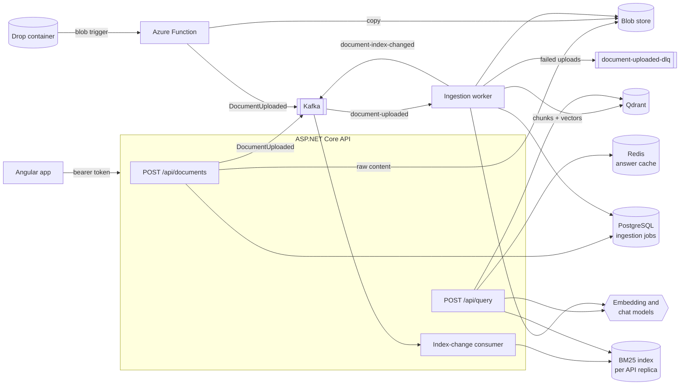

# Document Intelligence RAG

A multi-tenant retrieval-augmented question answering service for text and Markdown
documents. Uploads are stored in a blob store and ingested asynchronously through Kafka by a
separate worker (chunk, embed, upsert to Qdrant); questions are answered with hybrid search
(vector + BM25, fused with Reciprocal Rank Fusion), optional re-ranking and a chat model that
must cite the passages it used.

- **Backend:** ASP.NET Core 8 minimal API and a .NET 8 ingestion worker (`src/`)
- **Event-driven ingestion:** Kafka (Confluent.Kafka) with retries, a dead-letter topic and
  idempotent handling; an in-process channel replaces Kafka for local development and tests
- **Azure Functions:** a .NET 8 isolated-worker app with a blob-trigger drop zone and an
  HTTP status function
- **Storage:** Qdrant for vectors, PostgreSQL (EF Core) for ingestion jobs, Azure Blob
  Storage or a shared directory for raw uploads, Redis for cached answers
- **Frontend:** Angular 20 single-page app (`web/`)
- **Models:** any OpenAI-compatible endpoint (OpenAI, Ollama, vLLM, ...), or deterministic
  offline stand-ins so the system runs with no model and no credentials
- **Deployment:** Docker Compose for a local stack, a Helm chart for Kubernetes

## Architecture



### Ingestion

1. `POST /api/documents` authenticates the caller, validates the upload (`.txt`, `.text`,
   `.md`, `.markdown`; UTF-8; size limit) and its optional metadata (`tags`, `source`,
   `date`), writes the raw content to the blob store under `{tenant}/{documentId}/{file}`,
   records an ingestion job and publishes a `DocumentUploaded` message. It answers `202
   Accepted` with the job. The message carries a reference to the blob, a SHA-256 of the
   content and the request's correlation id, not the document itself.
2. With `Ingestion:Transport = Kafka` the message goes to the `document-uploaded` topic,
   keyed by tenant, through an idempotent producer, and the **ingestion worker**
   (`DocumentIntelligence.IngestionWorker`) consumes it as one consumer group. With
   `Ingestion:Transport = InProcess` the message goes to a bounded channel inside the API
   instead (`503` when it is full); local runs and the API tests use this mode.
3. Both transports call the same `DocumentUploadedHandler`:
   - **Idempotency.** The job record is created only if missing, and a message for a job
     that has already finished is ignored, so redelivery is harmless. If the tenant already
     has a document with the same content hash indexed, the job is marked `Duplicate` and
     points at that document instead of ingesting it twice.
   - **Retries.** Dependency and I/O failures are retried with exponential back-off
     (`Ingestion:MaxAttempts`, `RetryBaseDelayMilliseconds`, `RetryMaxDelayMilliseconds`);
     every attempt is counted on the job. Input that retrying cannot fix (missing blob, not
     UTF-8, unsupported type) fails immediately.
   - **Dead letters.** After the last attempt the job is marked `Failed` and the message is
     published to `document-uploaded-dlq` with `error` and `attempts` headers.
   - **Status.** Jobs move through `Queued`, `Processing`, `Completed`, `Failed` or
     `Duplicate` in PostgreSQL, with attempts, chunk count, error and timestamps. Updates are
     conditional `UPDATE` statements, so a finished job never moves backwards.
4. The `TextChunker` splits text into sentences and packs them into chunks of at most
   `Chunking:MaxTokens` tokens (`o200k_base`), with sentence-aligned overlap. Markdown
   headings are hard boundaries and each chunk records its heading path. Chunks are embedded
   in batches and upserted to Qdrant with the tenant id and document metadata in the payload;
   a failed batch removes the partially written document.
5. On success the handler invalidates the tenant's cached answers and publishes a
   `DocumentIndexChanged` event. Each API replica follows `document-index-changed` in its own
   consumer group and reloads that document's chunks from Qdrant into its in-memory BM25
   index. Kafka consumers store offsets only after a record has been handled or parked; a
   record whose handler throws is sought back to and retried, and unreadable records are
   moved to the dead-letter topic.

### Drop-zone ingestion with Azure Functions

`DocumentIntelligence.Functions` (isolated worker, .NET 8) offers a second way in:

- **`IngestDroppedBlob`** (blob trigger on the container named by the `DropContainer` app
  setting) handles files dropped at `{tenant}/{file}`. It validates them like the API does,
  copies them into the document blob store and publishes `DocumentUploaded` to Kafka. Job and
  document ids are derived from the blob path and content hash, so a repeated trigger
  republishes the same job and the worker skips it. Blob metadata `tags`, `source` and `date`
  become document metadata.
- **`IngestionStatus`** (HTTP, function key) serves
  `GET /api/tenants/{tenant}/ingestions[/{jobId}]` from the job database.

The function logic lives in plain classes (`BlobDropHandler`, `IngestionStatusQuery`) that
are unit-tested without the Functions host. Copy `local.settings.example.json` to
`local.settings.json` to run the app with Azure Functions Core Tools.

### Retrieval and answering

1. The caller's tenant (from the token) and optional `filters` (`tags` matching any of the
   given tags, `source`, inclusive `from`/`to` dates) form a `SearchFilter`. Qdrant receives
   it as a payload filter backed by payload indexes (the tenant field is indexed as Qdrant's
   tenant key); BM25 applies the same filter before scoring. Retrieval never crosses tenants.
2. Vector and BM25 rankings are fused with Reciprocal Rank Fusion
   (`score = Σ 1 / (k + rank)`), which uses ranks only, so cosine and BM25 scores never need
   calibrating against each other.
3. **Re-ranking (optional).** With `Retrieval:Reranker = Llm`, a wider pool
   (`Retrieval:RerankCandidates`) goes to `LlmReranker`, which shows the chat model the
   question and all candidates together, asks for a 0-10 grade per passage and keeps the best
   `topK`. Grades are parsed defensively and any model failure keeps the fused order. The
   default, `None`, keeps the fused order.
4. The chosen chunks go into a grounded prompt as numbered `<source>` blocks; the model must
   answer only from them and cite `[n]`. The markers are parsed and mapped back to chunks.
5. **Caching.** Answers are cached in Redis (or process memory) under a key built from the
   tenant, a per-tenant generation token and a SHA-256 of the normalised question (trimmed,
   lower-cased, whitespace collapsed), `topK` and the canonical filter. Ingesting or deleting
   a document replaces the tenant's generation token, which invalidates all of its cached
   answers at once. Cache failures are logged and treated as misses. Responses carry
   `X-Cache: hit|miss`.

### Security

- **Authentication.** Every endpoint except health probes and `/metrics` requires a JWT
  bearer token with a valid tenant claim (`Auth:TenantClaim`, default `tenant_id`).
  - `Auth:Mode = Jwt`: tokens from an OpenID Connect provider at `Auth:Authority`, issued
    for `Auth:Audience`.
  - `Auth:Mode = DevToken`: tokens signed with `Auth:DevToken:SigningKey` and issued for any
    tenant by `POST /api/auth/dev-token`. This is for local development and demos; the API
    refuses to start with it outside Development unless
    `Auth:DevToken:AllowOutsideDevelopment` is set (the compose stack sets it).
- **Tenant isolation.** The tenant always comes from the token. Uploads, document lists, job
  lookups, deletes and queries are confined to it, and another tenant's job or document is
  reported as not found. Every chunk carries its tenant id and every vector search filters on
  it.
- **Rate limiting.** Fixed one-minute windows per tenant (per client address when
  anonymous): a general limit plus stricter limits for queries and uploads, answered with
  `429` and `Retry-After`.
- **Request size limits.** JSON bodies are capped by `RequestLimits:MaxRequestBodyBytes`;
  uploads may carry one document of up to `Ingestion:MaxDocumentBytes`. Larger bodies get
  `413`.
- **CORS.** Allowed origins, methods, headers, exposed headers and preflight caching come
  from the `Cors` section.

### Observability

- **Metrics.** The `DocumentIntelligence` meter records `di.ingestion.lag` (seconds from
  upload to processing start), `di.ingestion.chunks` (its rate is chunks per second),
  `di.ingestion.documents` by outcome, `di.query.duration` by cache result and
  `di.query.cache.lookups` by result (hits over total gives the hit ratio). The API and the
  worker expose these, together with ASP.NET Core, HTTP client and runtime metrics, at
  `/metrics` in Prometheus format.
- **Correlation ids.** Each API request takes a well-formed `X-Correlation-ID` or falls back
  to the trace id. The id is echoed in the response, attached to every log event, tagged on
  spans and stored on the ingestion job. It travels in the `DocumentUploaded` message and as
  a Kafka header next to a W3C `traceparent`, so the worker's logs carry the same id and its
  consumer span joins the API's trace.
- **Tracing and logging.** OpenTelemetry spans for requests, outgoing HTTP calls, ingestion,
  retrieval, re-ranking and answering, exported over OTLP when `OTEL_EXPORTER_OTLP_ENDPOINT`
  is set; Serilog structured logs, compact JSON in containers.
- **Health.** `/health/live` and `/health/ready` on the API (vector store, job database,
  keyword index, and Kafka when used) and on the worker (vector store, job database, Kafka).

### Offline mode

With `Ai:Provider = Offline` (the default) embeddings come from `HashingEmbeddingClient`
(feature-hashed terms and trigrams) and answers from `ExtractiveChatClient` (verbatim source
sentences with citations). This keeps tests deterministic and lets the stack run without a
model; it has no semantic understanding. The LLM re-ranker needs a real chat model and is
refused at start-up in offline mode.

## Running locally

Prerequisites: .NET 8 SDK, Node.js 20.19+ or 22+, and optionally Docker.

```bash
# API on http://localhost:5080 with the Development settings: offline providers, in-memory
# vectors, SQLite job database, filesystem blob store, in-process ingestion, dev tokens
dotnet run --project src/DocumentIntelligence.Api

# Web app on http://localhost:4200 (proxies /api to the API)
cd web
npm ci
npm start
```

Sign in on the web app with any tenant name. Swagger UI is at `http://localhost:5080/swagger`
in Development.

### Example requests

```bash
TOKEN=$(curl -s -H "Content-Type: application/json" -d '{"tenant":"acme","user":"alice"}' \
  http://localhost:5080/api/auth/dev-token | jq -r .accessToken)

curl -H "Authorization: Bearer $TOKEN" -F "file=@handbook.md" -F "tags=hr,policy" \
     -F "source=wiki" -F "date=2024-03-01" http://localhost:5080/api/documents
curl -H "Authorization: Bearer $TOKEN" http://localhost:5080/api/ingestions/<job-id>
curl -H "Authorization: Bearer $TOKEN" -H "Content-Type: application/json" \
     -d '{"question":"How many vacation days do employees get?","topK":5,"filters":{"tags":["hr"]}}' \
     http://localhost:5080/api/query
```

## Running with Docker Compose

```bash
docker compose up --build
```

| Service    | URL / port              | Notes                                                 |
|------------|-------------------------|-------------------------------------------------------|
| `web`      | http://localhost:8080   | nginx serving the Angular build, proxying `/api`      |
| `api`      | http://localhost:5080   | API with the Kafka transport; applies migrations      |
| `worker`   | http://localhost:5090   | ingestion worker; health probes and `/metrics` only   |
| `kafka`    | localhost:9094          | Apache Kafka in KRaft mode, single node               |
| `postgres` | localhost:5432          | ingestion jobs                                        |
| `redis`    | localhost:6379          | answer cache                                          |
| `qdrant`   | http://localhost:6333   | vectors                                               |
| `ollama`   | http://localhost:11434  | only with `--profile ollama`                          |

The API and the worker share the blob store through a named volume. The stack signs in with
development tokens; set `DEV_TOKEN_SIGNING_KEY` to replace the default key. To use a local
model through Ollama:

```bash
AI_PROVIDER=OpenAICompatible AI_EMBEDDING_DIMENSIONS=768 QDRANT_COLLECTION=documents_nomic \
  docker compose --profile ollama up --build -d
docker compose exec ollama ollama pull llama3.2
docker compose exec ollama ollama pull nomic-embed-text
```

## Deploying to Kubernetes

`deploy/helm/document-intelligence` deploys the API, the worker and the web front end. It
expects Kafka, PostgreSQL, Redis and Qdrant to exist already and reads connection strings and
keys from an existing Secret (`secrets.existingSecret`, key names under `secrets.keys`); it
never creates secrets. Values cover image names, replicas, resources, CPU-based autoscaling
for the API and the worker, liveness and readiness probes, ingress, Prometheus scrape
annotations or ServiceMonitors, CORS origins and rate limits. The API applies migrations; the
worker does not. Uploads go to Azure Blob Storage by default, or to `FileSystem` with a
ReadWriteMany claim.

```bash
helm install di deploy/helm/document-intelligence \
  --set config.auth.authority=https://login.example.com/ \
  --set config.auth.audience=document-intelligence \
  --set config.kafka.bootstrapServers=kafka:9092
```

## Configuration

Settings come from `appsettings.json` and environment variables (`__` as the separator, for
example `Ingestion__Transport`). All options are validated at start-up.

| Setting | Default | Description |
|---|---|---|
| `Auth:Mode` | `Jwt` (`DevToken` in Development) | Token validation mode |
| `Auth:Authority` / `Auth:Audience` | empty | Identity provider and audience in `Jwt` mode |
| `Auth:TenantClaim` | `tenant_id` | Claim holding the tenant id |
| `Auth:DevToken:SigningKey` | Development only | HMAC key, at least 32 bytes |
| `Ingestion:Transport` | `InProcess` | `InProcess` (API only) or `Kafka` (API and worker) |
| `Ingestion:MaxAttempts` | `4` | Attempts before an upload is dead-lettered |
| `Ingestion:RetryBaseDelayMilliseconds` | `1000` | First retry delay, doubled per attempt |
| `Ingestion:RetryMaxDelayMilliseconds` | `30000` | Upper bound for retry delays |
| `Ingestion:MaxDocumentBytes` | `5242880` | Upload size limit |
| `Ingestion:QueueCapacity` | `100` | In-process channel capacity |
| `Ingestion:EmbeddingBatchSize` | `32` | Chunks per embedding request |
| `Kafka:BootstrapServers` | `localhost:9092` | Broker list |
| `Kafka:Topics:*` | `document-uploaded`, `document-uploaded-dlq`, `document-index-changed` | Topic names |
| `Kafka:IngestionConsumerGroup` | `ingestion-worker` | Worker consumer group |
| `Kafka:CreateTopics` | `true` | Create missing topics at start-up |
| `Kafka:SecurityProtocol`, `SaslMechanism`, `SaslUsername`, `SaslPassword` | unset | For managed clusters |
| `Persistence:Provider` | `Sqlite` | `Sqlite` (schema created from the model) or `Postgres` (migrations) |
| `Persistence:ConnectionString` | `Data Source=data/ingestion.db` | Job database |
| `Persistence:InitializeOnStartup` | `true` | Migrate or create the schema at start-up (API only) |
| `BlobStorage:Provider` | `FileSystem` | `FileSystem` or `AzureBlob` |
| `BlobStorage:FileSystem:RootPath` | `data/blobs` | Directory for raw uploads |
| `BlobStorage:AzureBlob:ConnectionString` or `ServiceUri`, `ContainerName` | `documents` container | Azure Blob Storage |
| `QueryCache:Provider` | `Memory` | `None`, `Memory` or `Redis` |
| `QueryCache:RedisConnection` | empty | StackExchange.Redis configuration string |
| `QueryCache:TtlSeconds` | `300` | Lifetime of a cached answer |
| `Retrieval:DefaultTopK` | `5` | Chunks given to the model when the request has no `topK` |
| `Retrieval:CandidatesPerRetriever` | `30` | Candidates per retriever before fusion |
| `Retrieval:RrfK` | `60` | RRF smoothing constant |
| `Retrieval:Reranker` | `None` | `None` or `Llm` |
| `Retrieval:RerankCandidates` | `20` | Candidates handed to the reranker |
| `RateLimiting:Enabled` | `true` | Per-tenant rate limiting |
| `RateLimiting:RequestsPerMinute` / `QueriesPerMinute` / `UploadsPerMinute` | `300` / `60` / `30` | Limits per tenant |
| `RequestLimits:MaxRequestBodyBytes` | `65536` | Body limit for requests other than uploads |
| `Cors:AllowedOrigins` | `[]` | Browser origins allowed to call the API directly |
| `Ai:*` | offline | Provider, base URL, key, models, embedding dimensions, temperature, timeout |
| `VectorStore:*` | `InMemory` | `InMemory` or `Qdrant` with URL, API key and collection |
| `Chunking:MaxTokens` / `OverlapTokens` | `256` / `40` | Chunk size and overlap |
| `OTEL_EXPORTER_OTLP_ENDPOINT` | unset | Export traces over OTLP |

## API

| Method | Path | Description |
|---|---|---|
| `POST` | `/api/auth/dev-token` | `{ tenant, user }` returns a development token (DevToken mode only, anonymous) |
| `POST` | `/api/documents` | Multipart `file` plus optional `tags`, `source`, `date`; returns `202` and the job |
| `GET` | `/api/documents` | The tenant's documents with chunk and token counts and metadata |
| `DELETE` | `/api/documents/{id}` | Removes a document's chunks |
| `GET` | `/api/ingestions` | The tenant's recent ingestion jobs, newest first |
| `GET` | `/api/ingestions/{id}` | One ingestion job |
| `POST` | `/api/query` | `{ question, topK?, filters?: { tags?, source?, from?, to? } }` returns `{ answer, citations[] }` |
| `GET` | `/health/live`, `/health/ready` | Liveness and readiness (anonymous) |
| `GET` | `/metrics` | Prometheus metrics (anonymous) |

Errors are RFC 9457 problem details: `400` validation errors with an `errors` map, `401`
without a valid token, `404` for unknown resources and other tenants' resources, `413` for
oversized bodies, `429` when rate limited, `502` naming the failing dependency, and `503` when
the in-process queue is full.

## Web app

The Angular app signs in with a development token for a chosen tenant (the session is kept
in `sessionStorage` and dropped when the API answers `401`), shows the signed-in tenant,
uploads documents with optional tags, source and date, lists the tenant's documents with
their metadata, and answers questions with optional tag, source and date filters. The
**Ingestion status** view lists jobs with status, attempts, chunk counts, errors and
duplicates; it polls every 2 seconds while anything is queued or processing (every 15
seconds otherwise) and keeps showing the last good list with a warning when a refresh fails.
Error messages come from the API's problem details, including rate limiting and expired
sessions.

## Design decisions

- **Messages carry a reference, not the document.** Raw content goes to the blob store, so
  messages stay small and the API, the worker and the blob-trigger function share one
  storage path.
- **At-least-once delivery made safe by idempotent handling** rather than exactly-once
  machinery: job state guards against reprocessing, content hashes catch duplicate uploads,
  and deterministic chunk ids make re-upserts overwrite.
- **BM25 stays in process.** Qdrant remains the store of record; each API replica rebuilds
  its keyword index at start-up and follows index-change events afterwards. The cost is
  memory proportional to the corpus on every replica.
- **One handler, two transports.** The in-process channel and Kafka call the same
  `DocumentUploadedHandler`, so local runs and tests exercise the production ingestion logic.
- **Generation-based cache invalidation.** One write per tenant invalidates every cached
  answer without scanning keys.
- **PostgreSQL migrations, SQLite for local work.** EF Core migrations target PostgreSQL; the
  SQLite database used locally and in tests is created from the same model.
- **Qdrant over REST.** The store uses a small typed REST client, which keeps dependencies
  small and makes requests easy to test with a stub HTTP handler.

## Production considerations

Done:

- Asynchronous ingestion through Kafka with retries, a dead-letter topic, idempotent
  handling and per-job status in PostgreSQL that survives restarts
- Tenant isolation enforced from the token down to the vector store filter
- JWT bearer authentication against a configurable authority, rate limits, body size limits
  and CORS configuration
- Prometheus metrics, OpenTelemetry traces across API, Kafka and worker, correlation ids in
  logs, liveness and readiness probes
- The API and worker images run as a non-root user; the Helm chart reads secrets from existing
  Secrets

Not done yet:

- No tooling to replay the dead-letter topic; parked messages have to be re-published by hand
- Migrations run from the API at start-up; several API replicas starting together against an
  empty database could race, which a separate migration job would avoid
- The BM25 index is held in memory on every API replica, which limits corpus size; a shared
  sparse index (for example Qdrant sparse vectors) would remove that
- Only UTF-8 text and Markdown are parsed; PDF and Office formats are not
- Dev-token sign-in grants any tenant to anyone who can reach the endpoint, so real
  deployments must use `Jwt` mode; roles within a tenant are not implemented
- The compose stack and the Helm chart have not been exercised end to end in this
  repository (the chart has not been rendered with `helm template`); Kafka, PostgreSQL, Redis
  and Qdrant must be provided separately for Kubernetes
- No load or soak testing has been done

## Project layout

```
src/
  DocumentIntelligence.Core/            Domain model, chunking, BM25, RRF, hybrid retrieval,
                                        filters, re-ranking, cache contract, ingestion pipeline
                                        and upload handler, messages, telemetry
  DocumentIntelligence.Infrastructure/  OpenAI-compatible clients, offline providers, Qdrant and
                                        in-memory vector stores, blob stores, EF Core job store
                                        and migrations, Kafka and in-process transports, Redis
                                        cache, DI registration
  DocumentIntelligence.Api/             Minimal API, authentication, tenancy, rate limiting,
                                        health, metrics, correlation ids, Dockerfile
  DocumentIntelligence.IngestionWorker/ Kafka consumer host for ingestion, Dockerfile
  DocumentIntelligence.Functions/       Azure Functions: blob-trigger drop zone, status endpoint
tests/
  DocumentIntelligence.UnitTests/       Core, infrastructure, messaging, persistence (SQLite)
                                        and worker wiring tests; no network needed
  DocumentIntelligence.Api.Tests/       WebApplicationFactory tests of the HTTP API
  DocumentIntelligence.Functions.Tests/ Tests of the function logic
web/                                    Angular app, nginx config and Dockerfile
deploy/helm/document-intelligence/      Helm chart
docker-compose.yml                      Local stack
```

## Tests

```bash
dotnet test
cd web && npm test -- --watch=false --browsers=ChromeHeadless
```

The .NET tests use the offline providers, stubbed HTTP handlers, in-memory SQLite job
databases and fakes for the message producer, so they need no Kafka, Qdrant, PostgreSQL,
Redis or model. New EF Core migrations are added with the pinned tool:

```bash
dotnet tool restore
dotnet ef migrations add <Name> --project src/DocumentIntelligence.Infrastructure --output-dir Persistence/Migrations
```

## License

[MIT](LICENSE)
